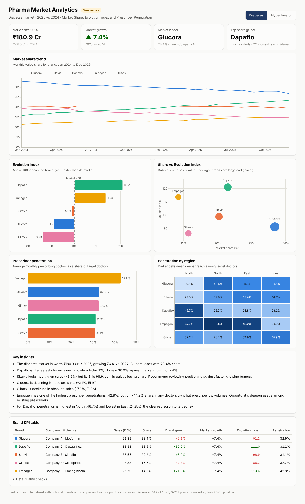
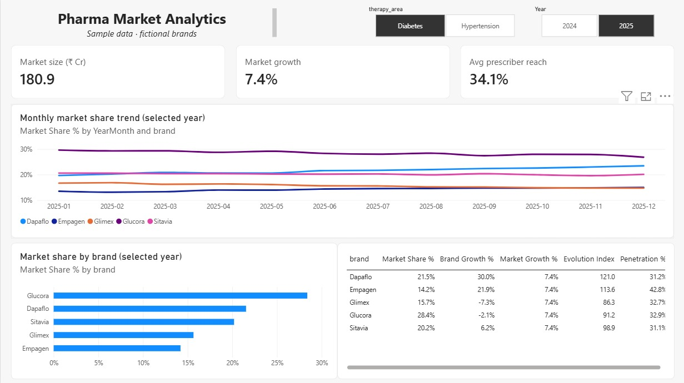
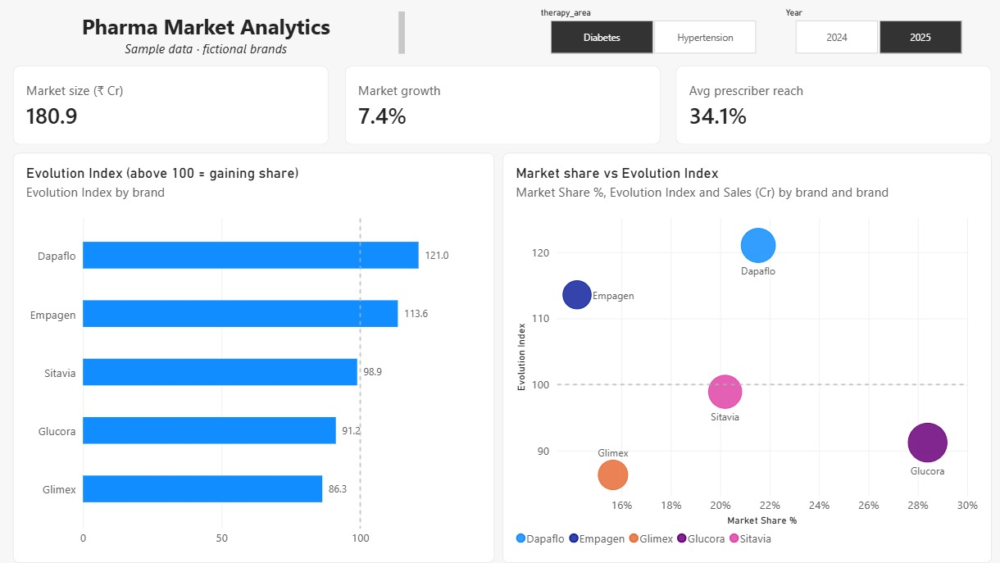
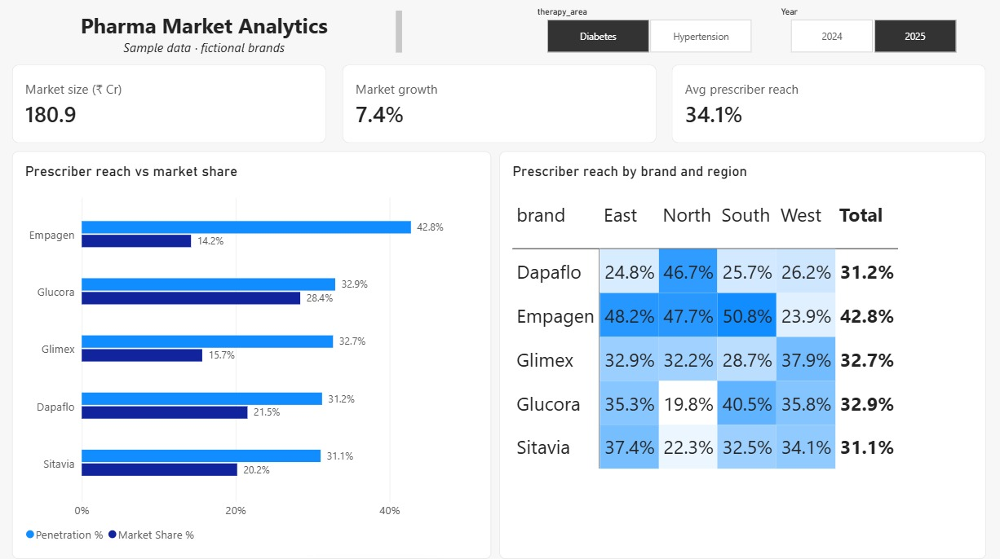

# Pharma Market Analytics: Automated KPI Pipeline & Dashboard

**Live dashboard:** https://noorullaferoz-commits.github.io/Pharma-market-analytics/outputs/dashboard.html

An automated Python + SQL pipeline that validates pharma sales data, computes the core commercial KPIs used in pharma market analytics (**Market Share**, **Evolution Index** and **Prescriber Penetration**), generates written insights, and builds an interactive dashboard, all with one command.

> **Data note:** this project uses a **synthetic sample dataset** with fictional brands and companies, designed to mimic monthly pharma secondary-sales data. No real company data is used.



## Run it

```bash
pip install -r requirements.txt
python pipeline/run_pipeline.py          # rule-based insight agent
python pipeline/run_pipeline.py --llm    # optional: LLM-written executive summary
```

Then open `outputs/dashboard.html` in a browser.

For the optional `--llm` step, set `LLM_BASE_URL`, `LLM_API_KEY` and `LLM_MODEL` for any OpenAI-compatible endpoint. If they are missing or the call fails, the pipeline falls back to rule-based insights.

## Pipeline steps

| Step | What happens | Output |
|---|---|---|
| 1. Validate | 12 data-quality checks: schema, nulls, negatives, duplicates, key integrity, monthly coverage, prescribers within the target universe | `outputs/data_quality_report.md` |
| 2. Load | CSVs loaded into a SQLite database | `outputs/pharma.db` |
| 3. Query | Runs the KPI SQL (joins, aggregations, window functions) | `sql/pharma_kpi_queries.sql` |
| 4. Compute | Market share, growth, Evolution Index and penetration for 2025 vs 2024, cross-checked against the SQL results | `outputs/kpi_summary.csv` |
| 5. Insight agent | Finds the share leader, share gainers, "hidden losers" (growing but EI < 100), reach-vs-share gaps and regional opportunities | `outputs/insights.md` |
| 6. Build | Interactive dashboard: therapy-area filter, trend, EI, share-vs-EI, penetration and regional heatmap, KPI table, light/dark mode, mobile layout | `outputs/dashboard.html` |

## KPI definitions

- **Market Share** = brand sales ÷ total sales of its therapy-area market
- **Evolution Index** = (1 + brand growth) ÷ (1 + market growth) × 100. Above 100 means the brand is gaining share.
- **Penetration Rate** = average monthly prescribing doctors ÷ target doctor universe

## Dataset

| Table | Rows | Description |
|---|---|---|
| `fact_sales` | 960 | Monthly sales (value, units, prescribing doctors): 10 brands × 4 regions × 24 months (2024–2025) |
| `dim_brand` | 10 | Brand, company, molecule, therapy area (Diabetes, Hypertension) |
| `dim_doctor_universe` | 8 | Target doctors per therapy area and region |

## Key insights (from the sample data)

- **Dapaflo** is the fastest share-gainer in diabetes (EI 121): +30.0% growth against a market growing 7.4%.
- **Sitavia** grew +6.2% but has an EI of 98.9, so it is quietly losing share despite growing.
- **Empagen** reaches the most diabetes prescribers (42.8%) but holds only 14.2% share, which is an opportunity to deepen usage.
- **Olmitra** leads hypertension share gains (EI 113), with the strongest reach in the East region.

## Power BI dashboard

The same KPIs rebuilt in Power BI Desktop: [`powerbi/Pharma_Market_Dashboard.pbix`](powerbi/Pharma_Market_Dashboard.pbix)

- **Data model:** star schema with `fact_sales`, `dim_brand`, a calculated `Date` table (marked as the date table) and `dim_doctor_universe` joined through `TREATAS`
- **12 DAX measures:** Sales, Market Sales (`CALCULATE` + `ALL`), Market Share %, Sales PY and Market Growth % (`SAMEPERIODLASTYEAR`), Evolution Index, average monthly prescribers (`AVERAGEX`), Penetration %
- **Interactivity:** therapy-area and year slicers, cross-filtering, edited visual interactions, conditional-format heatmap

| Page | What it answers |
|---|---|
| Market Overview | Market size, growth, reach, monthly share trend, share by brand |
| Brand Performance | Who is gaining or losing share (Evolution Index vs 100, share vs EI) |
| Penetration & Regions | Reach vs share gap, prescriber reach by brand × region |





## Tools

Python (pandas) · SQL (SQLite) · Power BI (DAX) · Plotly.js · optional LLM (OpenAI-compatible API)

## Structure

```
data/        sample CSV files
sql/         KPI queries
pipeline/    run_pipeline.py + dashboard template
outputs/     generated database, KPIs, insights, dashboard
dashboard/   screenshots
```
